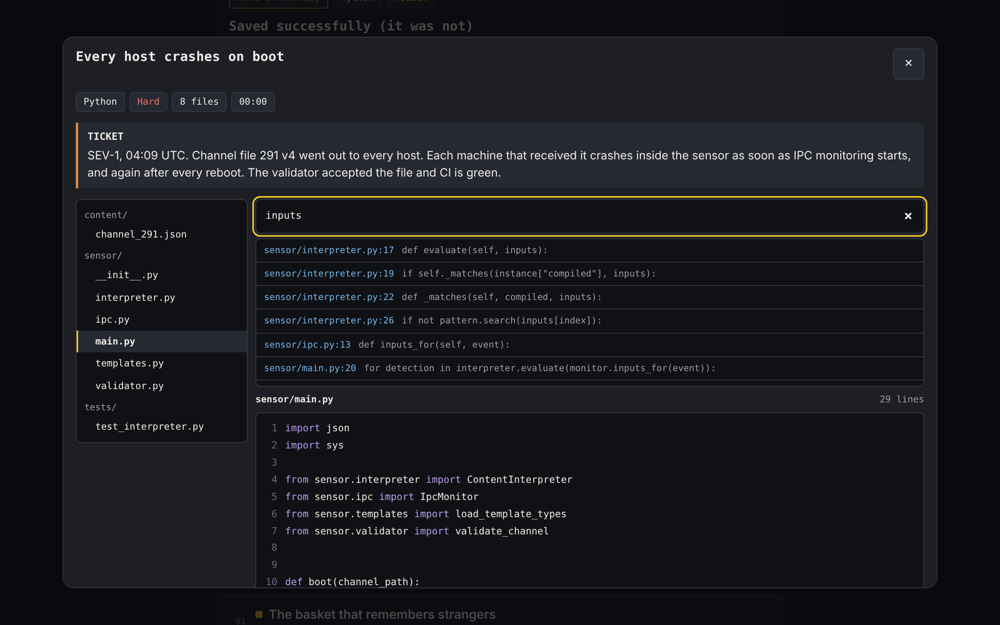

# Requack

**Spaced repetition for interview prep, with a rubber duck.**

You solved Two Sum in September. Could you solve it today? Requack schedules when to re-test everything you practise, makes you explain it to a duck before you see your notes, and trains you to review code the way OAs now ask: whole codebases with one bug in them.

**Live:** https://andreasm79.github.io/requack/

<p>
  
  
  
</p>



## What it does

- **Recall queue.** Log a solve with the trick in one line. Each problem comes back right before you'd forget it: tomorrow on a FAIL, weeks out on an O(1).
- **Duck recall.** On recall day you explain the approach first, then see your notes and grade yourself. One button runs every due recall back to back.
- **Repo hunts.** Six multi-file codebases (8 to 13 files) with a file tree, grep and an incident ticket, each modelled on a real public write-up: Cloudflare's 2019 regex outage, CrowdStrike's Channel File 291, Knight Capital, Log4Shell, Apple's goto fail and the Mars Climate Orbiter. The source is linked once you've solved it.
- **Snippet hunts.** 24 short ones in Python, JavaScript, Java, SQL and C.
- **Mock OA.** Two snippets and a repo, timed, fullscreen, copy and paste blocked, tab switches logged, and an integrity report at the end, like HackerRank and CodeSignal.
- **Add anything.** Coding, system design, behavioural, concepts, with your own topic, question and link.
- **Already solved some?** Tick them in bulk and they join the queue spread over two weeks.
- **Progress.** Mastery by topic, weakest topic with a one-tap drill, 14-day forecast, streak, and a stats block to paste in Discord.
- **Daily reminder.** A repeating Google Calendar event or an .ics file.
- **Light and dark**, keyboard shortcuts (`/` search, Enter, 1 to 4 to grade), undo on every grade.
- **No account, no server.** Data stays in your browser, with export and restore.

Inside Claude, the Bugs page can also generate hunts: a quick snippet, or a whole practice repo built from a bug report you paste in. That needs Claude, so it's hidden on GitHub Pages.

## Run it

No build step.

```
npm start              # serves on http://localhost:8080
npm test               # unit tests, Node 22+
npm run build:hunts    # after editing anything in hunts-src/
```

## Add a bug hunt

Each hunt is a folder in `hunts-src/`:

```
hunts-src/my-hunt/
  hunt.json    title, lang, difficulty, tag, ticket, explanation, optional source
  fix.txt      the corrected code
  repo/        the files, exactly as the player sees them
```

Start every buggy line with `!!` (before the indentation). Add the folder name to `ORDER` in `scripts/build-hunts.mjs`, then run `npm run build:hunts`. A test fails if the generated file is out of date.

## Structure

```
index.html
css/styles.css
hunts-src/              repo and snippet hunts as plain files
scripts/build-hunts.mjs turns hunts-src into js/data/repos.js
js/app.js               router, shortcuts, command palette wiring
js/data/                NeetCode 150 / Blind 75, snippet hunts, generated repo hunts
js/core/                scheduler, stats, storage, reminders, hunt generation (no DOM)
js/ui/                  sheets, sessions, code viewer, hunt player and OA mode, theme
js/ui/views/            Today, Problems, Bugs, Progress, More
tests/                  node:test suites for the core and the hunt data
```

## Schedule

SM-2 style. First attempt: 1, 2, 4 or 7 days depending on how it went. After that a good recall multiplies the interval by the card's ease (starts at 2.5), a shaky one grows it by 20%, an instant one by ease × 1.3, and a fail resets it to 1 day and lowers the ease. Intervals cap at 180 days. An item is mastered once its interval reaches 21 days.

Requack is not affiliated with LeetCode, NeetCode, HackerRank or CodeSignal. Built for the DUCSS Project of the Month, November 2026.
