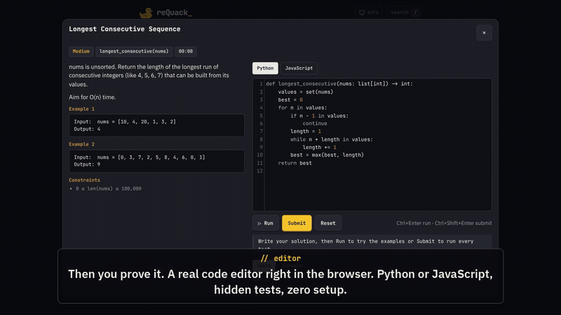
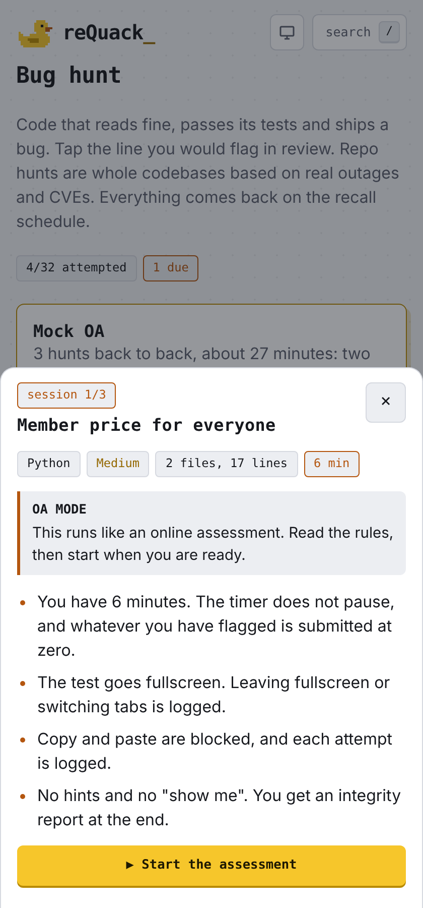

<div align="center">

# 🦆 reQuack

**Solve it once. Remember it at the interview.**

Spaced repetition for coding interview prep, with a rubber duck that makes you explain yourself.

[**Try it live →**](https://andreasm79.github.io/requack/)



</div>

---

## The problem

You solved Two Sum in September. Could you solve it today, in an interview, with a timer running?

Most people grind LeetCode, move on, and forget. reQuack brings every problem back right before you'd forget it, makes you explain the approach before you see your notes, and trains the things OAs now test: hidden test cases, real codebases with one bug in them, and proctored timed rounds.

No install. No server. It all runs in your browser.

## Features

### 🧠 Remember what you solve
- **Recall queue.** Log a solve with the key trick in one line. It comes back tomorrow if you failed, or weeks later if it was easy.
- **Duck recall.** Explain the approach to the duck first, then see your notes and grade yourself. One button runs every due recall back to back.
- **Progress.** Mastery by topic, your weakest topic with a one-tap drill, a 14-day forecast, streaks, and a stats card to share.
- **Daily reminder** as a Google Calendar event or an `.ics` file.

### 💻 Write and run real code
- **In-browser editor** for Python (via Pyodide) and JavaScript, with syntax highlighting.
- **29 runnable problems**, each with about 25 hidden tests, time limits, output and tracebacks. Statements are original and map to NeetCode 150 problems.

### 🐛 Bug hunts in real codebases
- **8 multi-file repos** (8 to 13 files each) with a file tree, grep and an incident ticket. Six are modelled on real outages: Cloudflare's 2019 regex meltdown, CrowdStrike's Channel File 291, Knight Capital, Log4Shell, Apple's `goto fail` and the Mars Climate Orbiter.
- **Fix & test.** Open the Python and JavaScript repos in an IDE, edit any file, run the repo's own tests in a terminal, then submit against hidden acceptance tests.
- **24 snippet hunts** in Python, JavaScript, Java, SQL and C.

### ⏱️ Mock OAs
- **Coding OA.** The duck draws 2 to 4 random problems from any list you choose. Timed, fullscreen, with copy and paste blocked.
- **Code review OA.** Two snippets and a repo hunt under the same rules.
- **Proctoring.** Tab switches, leaving fullscreen and paste attempts are flagged in an integrity report, like HackerRank and CodeSignal.

### 📋 Your lists, your problems
- **Import any list.** Paste a company list, a Discord pin or spreadsheet rows. Known problems are matched automatically and the rest are added with their links.
- **Add anything.** Coding, system design, behavioural or concept questions, with your own topic and link.
- **Already solved some?** Tick them in bulk and they're spread over the next two weeks.

### ✨ The rest
- **Optional sign-in** syncs your queue, lists and code between laptop and phone.
- **Light and dark mode**, keyboard shortcuts (`/` search, `Ctrl+K` commands, `1`–`4` to grade) and undo on every grade.
- **Works without an account.** Data stays in your browser, with export and restore.

## Screenshots

<p align="center">
  
  
  
</p>

<p align="center">
  
</p>

<p align="center">
  
</p>

<p align="center">
  
</p>

## How the schedule works

reQuack uses an SM-2 style scheduler.

| How it went | Next review |
|---|---|
| First attempt | 1, 2, 4 or 7 days, depending on how it went |
| Good recall | interval × the card's ease (starts at 2.5) |
| Shaky recall | interval grows by 20% |
| Instant recall | interval × ease × 1.3 |
| Fail | back to 1 day, and the ease drops |

Intervals cap at 180 days. A problem counts as mastered once its interval reaches 21 days.

## Run it locally

No build step and no dependencies to install for the site itself. Node 22+ is only needed for tests and the build scripts.

```bash
git clone https://github.com/andreasm79/requack.git
cd requack
npm start               # http://localhost:8080
npm test                # unit tests
npm run build:hunts     # after editing hunts-src/
npm run build:problems  # after editing problems-src/bank.mjs
```

### Enable sign-in on your own fork

Sign-in uses [Supabase](https://supabase.com).

1. Create a Supabase project and run [`supabase/schema.sql`](supabase/schema.sql) in its SQL editor. It creates one table with row-level security, so each user can only read and write their own data.
2. Under **Authentication → URL Configuration**, set the Site URL and a Redirect URL to where you host the site.
3. Put the project URL and the publishable (anon) key in [`js/config.js`](js/config.js). Leave both empty to hide sign-in.

Never put the secret or `service_role` key in the site.

## Contributing

### Add a bug hunt

Each hunt is a folder in `hunts-src/`:

```
hunts-src/my-hunt/
  hunt.json     title, lang, difficulty, tag, ticket, explanation, optional source
  fix.txt       the corrected code
  repo/         the files, exactly as the player sees them
  acceptance/   optional: tests that fail with the bug and pass once fixed
```

Start every buggy line with `!!` (before the indentation). Adding `acceptance/` to a Python or JavaScript repo turns on Fix & test. Add the folder name to `ORDER` in `scripts/build-hunts.mjs` and run `npm run build:hunts`. A test fails if the generated file is out of date.

### Add a runnable problem

Add an entry to `problems-src/bank.mjs` with an original statement, examples, a reference solution and a random input generator, then run `npm run build:problems` to generate the tests. Use the NeetCode slug as the id so lists and recalls pick it up.

## Project structure

```
index.html
css/
  styles.css             design tokens, light and dark themes
  vendor/                CodeMirror 5.65.16 stylesheet (MIT)
js/
  app.js                 router, shortcuts, command palette
  config.js              Supabase URL and publishable key (empty = no sign-in)
  core/                  scheduler, stats, storage, lists, judge, reminders, sync (no DOM)
  data/                  NeetCode 150 / Blind 75, hunts, generated problems
  ui/                    editor, solve screen, repo IDE, OA modes, proctoring, account
  ui/runtime.js          Python and JavaScript workers with time limits
  ui/views/              Today, Problems, Bugs, Progress, More
hunts-src/               bug hunts as plain files, with hidden acceptance tests
problems-src/bank.mjs    runnable problems: statements, solutions, generators
scripts/                 build steps for hunts and problems
supabase/schema.sql      sync table and row-level security
tests/                   node:test suites
```

## Built with

Vanilla JavaScript (ES modules) · [Pyodide](https://pyodide.org) · [CodeMirror 5](https://codemirror.net/5/) · [Supabase](https://supabase.com) · GitHub Pages

---

<div align="center">

Built by [Andreas Mama](https://github.com/andreasm79) for the DUCSS Project of the Month, November 2026.

reQuack is not affiliated with LeetCode, NeetCode, HackerRank or CodeSignal.

</div>
